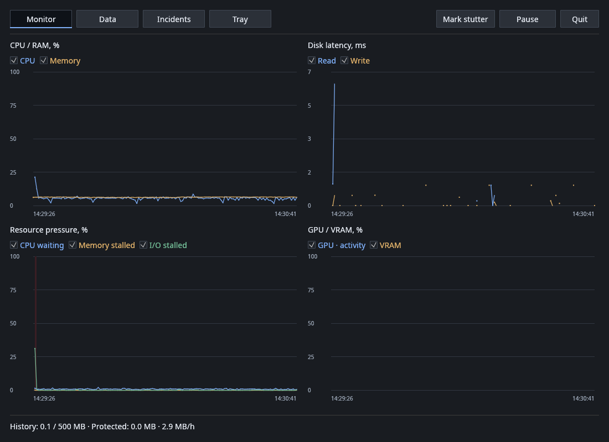

<p align="center"></p>
<h1 align="center">Stutter Watch</h1>
<p align="center">A local performance recorder for Windows and Linux.</p>

[Download](https://github.com/flochiii/stutter-watch/releases) · [Windows](docs/WINDOWS_PORTABLE.md) · [Linux](docs/LINUX.md) · [Documentation](docs/GETTING_STARTED.md)

Stutter Watch records system activity in the background and saves the context around freezes. Open an incident to inspect its charts and measurements. No accounts or log uploads.



## Features

- CPU, memory, disk and GPU monitoring.
- Automatic highlights for high load and measured delays.
- Bookmarks that preserve 30 seconds before a stutter and 10 seconds after it.
- Compressed history with configurable storage limits.
- Background recording, tray controls and a global bookmark shortcut.
- Ten interface languages.


## Use

1. Open Stutter Watch and leave it running.
2. When a freeze happens, press **Ctrl+Shift+F12** or **Mark stutter**.
3. Open **Incidents** to view the recording.

Closing the window keeps recording. **Quit** stops the application. History defaults to **500 MB / 24 hours**; bookmarked incidents are protected from rotation.

## Build

Requires Rust 1.97.1 and the [Windows](docs/WINDOWS_PORTABLE.md) or [Linux](docs/LINUX.md) build dependencies.

```sh
cargo build --locked --release
```

[Data & privacy](docs/DATA_AND_PRIVACY.md) · [Contributing](CONTRIBUTING.md) · [Roadmap](docs/ROADMAP.md)

## License

[PolyForm Noncommercial 1.0.0](LICENSE). Commercial use outside the license's permitted purposes requires permission. Dependencies retain their [own licenses](THIRD_PARTY_NOTICES.md).
