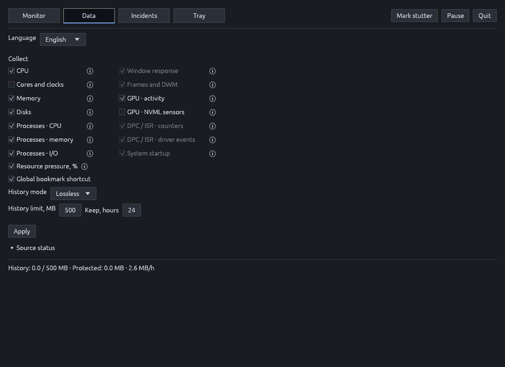

<p align="center"></p>

<h1 align="center">Stutter Watch</h1>

<p align="center">Record intermittent stutters. Keep the context. Inspect it locally.</p>

[](https://github.com/flochiii/stutter-watch/actions/workflows/ci.yml)
[](https://github.com/flochiii/stutter-watch/actions/workflows/linux.yml)
[](LICENSE)


Stutter Watch is a local performance recorder for Windows and Linux, written in Rust. It keeps a rolling history while you work and preserves the time around a bookmark or an automatic signal. Reopen the desktop panel to inspect charts and incidents without sending recordings anywhere.

[Downloads](https://github.com/flochiii/stutter-watch/releases) · [Windows guide](docs/WINDOWS_PORTABLE.md) · [Linux guide](docs/LINUX.md) · [Data & privacy](docs/DATA_AND_PRIVACY.md) · [Contributing](CONTRIBUTING.md)


*Actual Linux desktop captured in an isolated X11 test. Available GPU measurements depend on the machine and driver.*

## Downloads and installation

**v0.2 is being validated.** It adds a per-user Windows installer and Linux `.deb`, `.rpm` and AppImage packages. Verified downloads will be attached to the release after validation. The earlier [v0.1 Windows preview](https://github.com/flochiii/stutter-watch/releases/tag/v0.1.0) is a portable ZIP: extract it and open `stutter-watch.exe`.

The Windows installer preserves settings and recordings during updates. Linux packages require x86_64 and glibc 2.35 or later. See the platform guides for desktop dependencies, permissions, checksums and startup behavior. Windows executables are unsigned.

## Everyday use

1. Open Stutter Watch and leave the recorder running while you work.
2. When you notice a freeze, press **Ctrl+Shift+F12** or **Mark stutter**. The bookmark preserves 30 seconds before it and requests ten seconds afterward.
3. Open **Incidents** to inspect the recording. Your own recordings appear automatically. Closing the panel keeps the recorder running; reopening restores up to ten minutes of history.

Ordinary history defaults to **500 MB / 24 hours**, whichever limit is reached first. Protected bookmarks survive ordinary history rotation. Choose lossless LZ4 history or smaller, lossy summaries with full incident captures. **Quit** stops the recorder and saves pending data.

## Features and sources

| Capability | Windows | Linux |
| --- | --- | --- |
| Local charts, protected bookmarks, compressed history and reports | Yes | Yes |
| Selectable CPU, RAM, disk and process collection | Yes | Yes |
| Configurable tray and global bookmark shortcut | Native tray / hotkey | StatusNotifierItem / X11 or Wayland portal |
| GPU activity and guarded details | Windows counters / NVML | DRM fdinfo / sysfs / guarded NVML |
| Present API work, DPC/ISR and window-response probes | ETW / Win32 | Provider unavailable; explained in Data |
| Resource pressure signals | Windows counters | Kernel PSI |
| Optional local MangoHud CSV viewing | Yes | Yes |

New shared workflows are implemented on both platforms. Provider-specific measurements retain their actual meaning. High CPU utilization alone is not a stutter; yellow marks load pressure and red marks measured delays or critical resource signals. An annotation is evidence to inspect, not proof of a cause. Missing measurements stay unavailable.

The optional MangoHud import opens an existing game log in the same incident viewer. It is unnecessary for Stutter Watch's own recordings and does not enable live game FPS collection. Imported frame time uses a relative timeline rather than an invented system timestamp.



*Choose what to collect. Hover an information icon for its purpose and availability reason. English defaults and ten interface languages are included.*

## Your data

No accounts, analytics or automatic log uploads. Window titles are off by default; process names and PIDs can still identify applications. Review recordings before sharing them. Protected captures have separate usage and are not automatically deleted. Read [data and retention](docs/DATA_AND_PRIVACY.md) for storage locations and limits.

## Build and test

Use **Rust 1.97.1**. Windows needs MSVC C++ Build Tools and Windows SDK; Linux build dependencies are listed in the [Linux guide](docs/LINUX.md).

```sh
cargo build --locked --release
cargo fmt --check
cargo clippy --locked --all-targets -- -D warnings
cargo test --locked --all-targets
```

CI verifies Windows installation, updates and rollback, and launches Linux under X11 and native Wayland. Screenshots come from the running application. [Release tooling](docs/RELEASING.md) builds installable packages, checksums and dependency notices. Hardware and desktop coverage still depend on real-world testing; CI is not a guarantee for every driver or game.

[Architecture and limits](docs/ARCHITECTURE.md) · [Roadmap](docs/ROADMAP.md) · [Report an issue](https://github.com/flochiii/stutter-watch/issues)

## License

Stutter Watch is available under [PolyForm Noncommercial 1.0.0](LICENSE). Commercial uses outside its permitted purposes require separate permission from the copyright holder. Dependencies retain their own terms; see [third-party notices](THIRD_PARTY_NOTICES.md).
