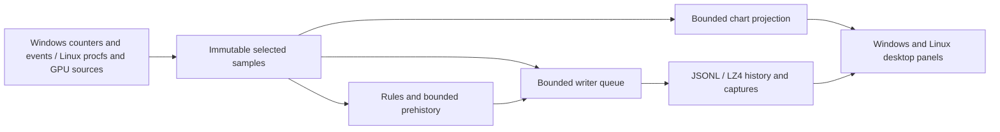

# Architecture and measurement limits

[README](../README.md) · [Getting started](GETTING_STARTED.md) · [Data and privacy](DATA_AND_PRIVACY.md)

## Pipeline

`sources.rs` plans dependencies and collector lifecycles. `collectors/` reads counters and events. `detector.rs` builds capture windows; `assessment.rs` shares severity rules with charts and reports. `recorder.rs` owns the bounded writer pipeline and `storage.rs` owns persistence and retention.

`src/linux/` provides the Linux recorder, desktop and session integrations. The desktop and recorder communicate over a private local Unix socket. Closing the desktop leaves the recorder running. Linux collection uses procfs, PSI and guarded GPU sources; Windows collection uses PDH, ETW and Win32. Missing providers retain their actual availability rather than being replaced with unrelated measurements.

`design.rs` defines the shared palette, fonts, spacing and chart geometry. Windows renders native buffered controls with GDI; Linux uses egui with OpenGL. Both use the same configuration, storage, assessment, reports and translations.

Samples are shared using `Arc` across recent history, pending captures, and the writer. Overlapping marks retain independent finite capture windows. Summary mode aggregates only ordinary history; incident samples remain full.

`history.rs` maintains a chart projection independently of the panel. Recent recovery is bounded by time, points, files, and bytes read. `panel.rs` draws four charts with min/max-preserving downsampling and gaps between unavailable intervals. `theme.rs` and `tray_popup.rs` paint buffered native controls and a persistent hover popup. Closing the panel frees its graphics resources while collection continues.

## Measurement limits

| Signal | Meaning and limit |
| --- | --- |
| CPU / RAM | High use indicates pressure, not proof of a visible stutter or its cause. |
| Present / DWM | Measured API/compositor work where available; not full PresentMon scan-out correlation. Static gaps between frames are not delays by themselves. |
| Window response | A separate 50 ms probe uses `WM_NULL` with a 20 ms timeout. This is not the end-to-end duration of every user action. Only a confirmed timeout means unresponsive; other failures are unknown. |
| Disk counters | Counter interval measurements can show pressure and latency but do not identify every blocking call. |
| DPC / ISR | Counter activity and decoded driver events are correlated by their timestamps. Some providers need privileges. |
| NVIDIA sensors | NVML is gated by activity, PCI identity, and a confirmed recent D0 state. Unknown prerequisites mean no polling. Recent PnP power state is not proof of D3cold. |
| Process summaries | Selected top processes and sampled counters, not a complete scheduler or allocation trace. |
| Linux pressure | PSI measures time waiting for CPU, memory or I/O. It is distinct from utilization and does not identify a specific application's cause. |
| MangoHud import | Existing local CSV recordings, using their relative elapsed timeline. Import does not start live game FPS collection. |

Enabled ETW sources may need administrator privileges or suitable Windows group membership. Unsupported hardware, unavailable counters, or provider errors affect that source; they do not turn missing values into zeros. Short checks do not establish detection accuracy on all Windows builds, drivers, and workloads.

## Automatic assessment

- CPU at least 95% or RAM at least 90% is yellow pressure. These percentages alone do not create a measured-delay incident.
- RAM at least 95%, with available memory below 5% of total clamped to 256 MiB–1 GiB, is a red memory-pressure signal and can trigger an incident. It is a resource heuristic, not a causal diagnosis.
- Measured work uses the configuration's thresholds: defaults include 100 ms Present/DWM, 150 ms window unresponsiveness, 50 ms disk latency, 15% DPC/ISR, and 2 ms driver events. Advanced thresholds are in TOML.
- Lock/sleep, long collection gaps, static Present gaps, and stale DPC delivery are filtered. Downsampling preserves short severity signals without painting across missing intervals.

An incident's peaks describe the whole capture and need not be simultaneous. For stack attribution, end-to-end frame timing, and a deeper ETL investigation, use tools such as WPR/WPA and PresentMon alongside this recorder.

## Compatibility and validation

The build targets Windows x64/MSVC. Automated checks cover serialization fidelity, retention, manual capture windows, source gating, config migration, chart recovery, assessment boundaries, localization keys, and native popup placement/lifetime. Native UI has had short interactive checks; multi-monitor DPI, accessibility, localization quality, long-running behavior, and broader hardware coverage remain ongoing work.

No portable resource-budget claim is made from a short test on one machine. A reproducible benchmark should state enabled sources, privileges, UI state, hardware, duration, and measurement method.
